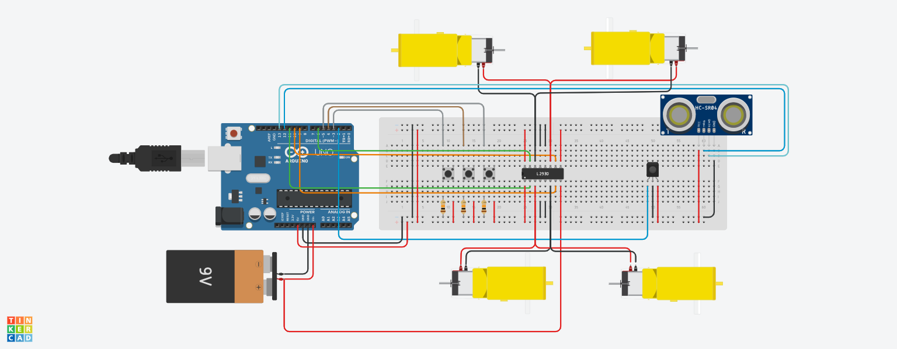
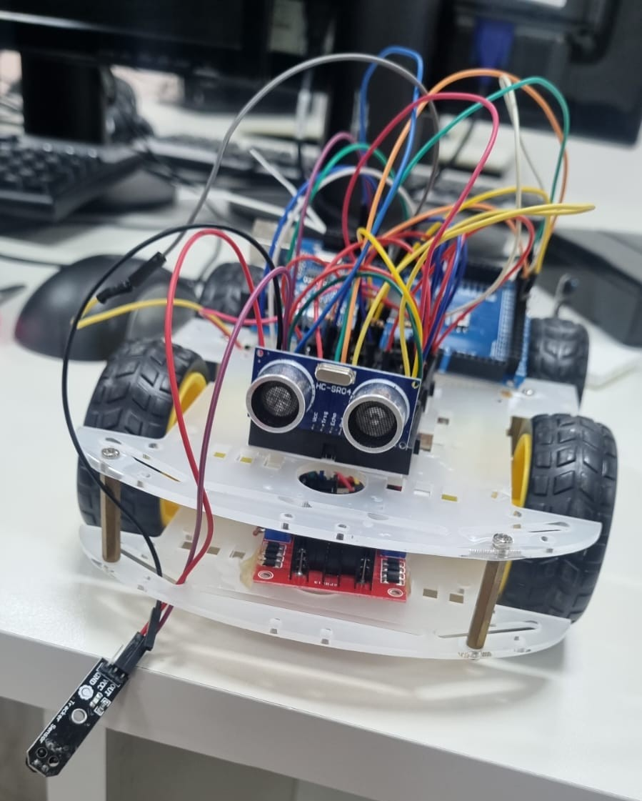

# SUMÔ AUTÔNOMO

## Objetivo
Desenvolvimento de um Sumô Autônomo para o Portas Abertas 2026 da UNIFESP, representado pela Disciplina **Sistemas Embarcados**.

## Sobre o projeto
O Sumô Autônomo utiliza um sistema embarcado baseado em Arduino para controlar os motores e interpretar os dados recebidos pelos sensores. A partir dessas informações, ele toma decisões de movimentação para localizar o adversário, atacar e evitar sair da arena.

## Componentes
* 1 Arduino Mega 2560;
* 1 Sensor Ultrassônico;
* 1 Sensor Infravermelho;
* 4 Motores DC 3-6V com caixa de redução e eixo duplo;
* 1 Módulo Ponte H L298N;
* 3 Push Buttons;
* 3 Resistores de 10 kΩ;
* 1 Bateria Lipo 3s 2200mah 11.1V com conector XT60;
* 1 Chassi de Sumô (carcaça, 4 rodas, parafusos);
* 1 Power Button;
* 1 Mini Protoboard Breadboard 170 Pontos;
* MUITOS Jumpers macho-macho e macho-fêmea.

## Funcionamento Geral
O sistema de controle utiliza os sensores (ultrassônico e infravermelho) para determinar as ações do robô durante o combate.
* **Inicialização**: configura os pinos, os sensores e os acionamentos dos motores.
* **Busca pelo oponente**: utiliza o sensor ultrassônico para identificar um possível adversário.
* **Ataque**: executa movimentos de aproximação conforme a estratégia selecionada nos push buttons.
* **Proteção da arena**: utiliza o sensor infravermelho para identificar a proximidade dos limites e evitar que o robô saia da área de combate.
* **Controle dos motores**: aciona os motores por meio da ponte H, permitindo avançar, recuar e realizar curvas e giros.

## Tecnologias utilizadas
* **Placa:** Arduino Mega 2560.
* **Microcontrolador:** ATmega2560.
* **Linguagem de programação:** C++.
* **IDE:** Arduino IDE.
* **Simulação:** Tinkercad Circuits.
* **Versionamento:** Git e GitHub.

### Protótipo realizado no Tinkercad Circuits

**Observações**
Para a realização dos testes virtuais, foi preciso realizar algumas alterações do circuito real para o circuito virtual:
- O Tinkercad **não possui L293N**, foi preciso utilizar o **L293D**.
- O Tinkercad também **não possui Arduino MEGA 2560**, então foi preciso utilizar o **Arduino UNO**.
- Para realizar a depuração do funcionamento do código, foi necessário trocar o **sensor infravermelho** por um **switch deslizante**.
- Apenas é possível realizar **testes com 2 motores** por vez (um de cada lado). O Tinkercad **não suporta 4 motores** na ponte H, ocorre erro de **inicialização**.
- **Não** é possível utilizar a **biblioteca NewPing**.

## Futuras melhorias
* Aprimorar a identificação e a localização do oponente por meio do sensor ultrassônico.
* Desenvolver e comparar diferentes estratégias de ataque, buscando melhorar o desempenho nas competições.
* Ajustar a velocidade e a resposta dos motores para otimizar as manobras do robô.
* Adicionar um segundo sensor infravermelho, ampliando a capacidade de detecção das bordas da arena, uma vez que a versão atual foi desenvolvida com a limitação de utilizar apenas um sensor.
* Implementar um acelerômetro para obter informações sobre a aceleração e os movimentos do robô, possibilitando explorar novas estratégias de controle.

### Imagem do Sumô Autônomo Finalizado

